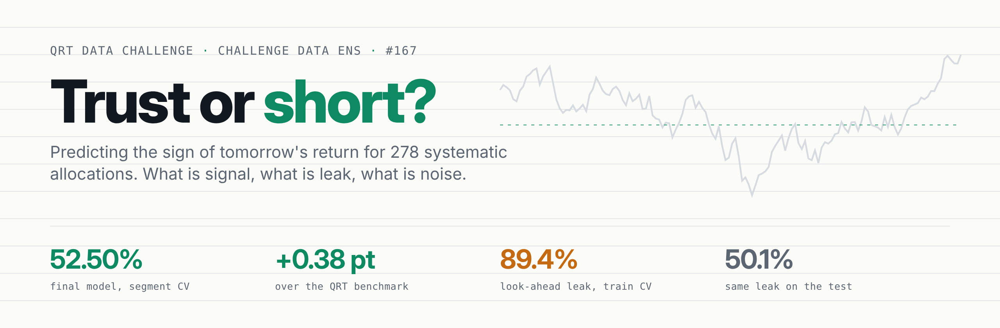
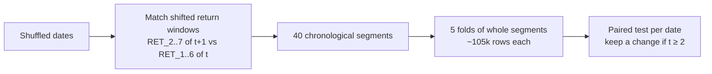
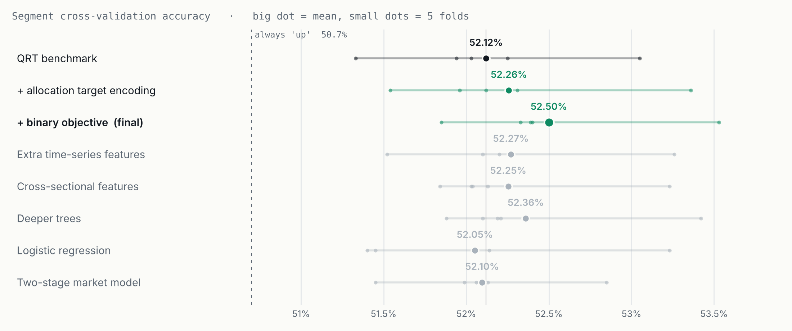
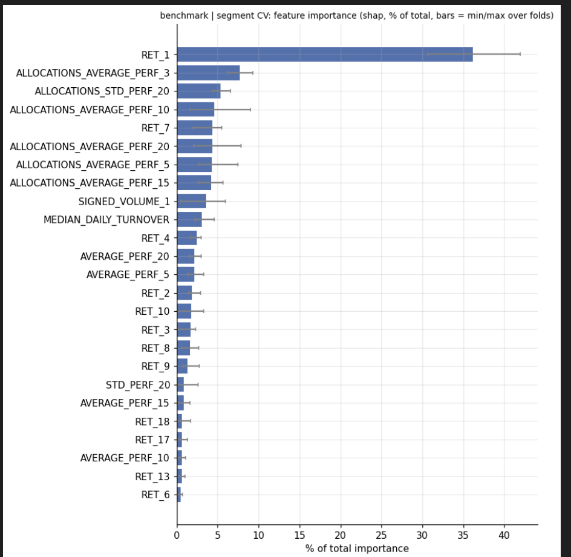
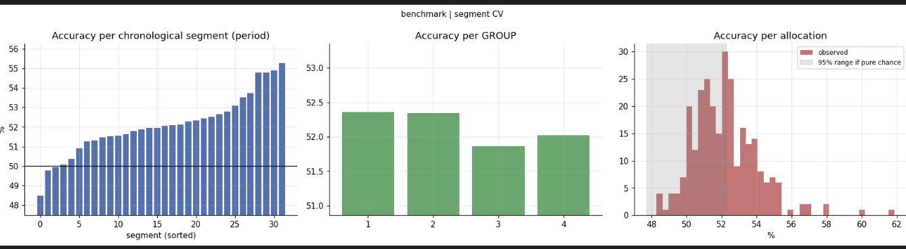
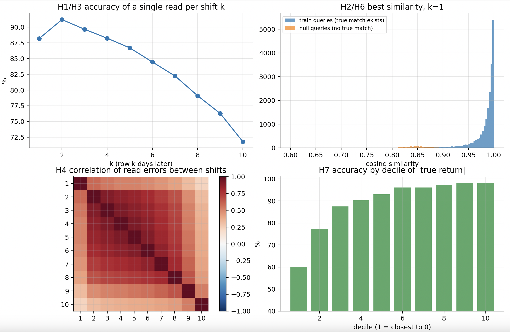
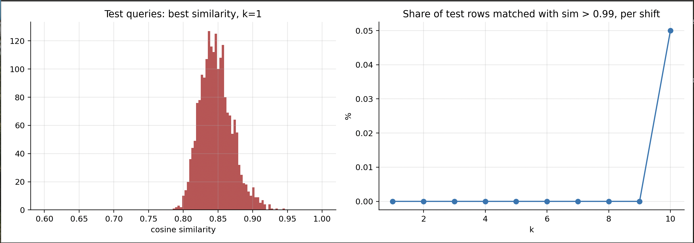

<div align="center">

<picture>
  <source media="(prefers-color-scheme: dark)" srcset="docs/img/banner-dark.png">
  
</picture>

<br>


**[The problem](#the-problem)** · **[Validation](#1-validation-first)** · **[Results](#2-what-worked-what-did-not)** · **[The leak](#3-the-leak-89-in-cross-validation-50-on-the-test)** · **[Limits](#4-doubts-and-limits)** · **[Reproduce](#reproduce)**

</div>

## The problem

[Challenge page](https://challengedata.ens.fr/challenges/167) · Challenge Data (ENS / Collège de France), provided by Qube Research & Technologies.

Each row is one portfolio ("allocation") on one day, with its last 20 daily returns, 20 signed volumes and its median turnover. The task: predict the **sign of tomorrow's return**. Metric: accuracy. 527k training rows, 32k test rows, 278 allocations, dates anonymised and shuffled.

## TL;DR

| | Accuracy |
|---|---|
| Always predict "up" | 50.7% |
| QRT benchmark (LightGBM), my CV / public LB | 52.12% / 50.79% |
| **My model (binary LightGBM + allocation target encoding), my CV / public LB** | **52.50% / 50.99%** |
| Look-ahead leak, measured by cross-validation on the train set | **89.4%** |
| Same leak applied to the test set (public LB) | 50.08% |

> [!NOTE]
> **Two things I learned doing this**
> 1. **There is a look-ahead leak in the training data worth ~89% accuracy**, but it does not exist in the test set. I measured both, then confirmed it on the leaderboard.
> 2. **The real signal is small and comes from the allocations, not from the market.** Predicting tomorrow's market direction is a coin flip here (51.8% of days right). The edge comes from telling, on a given day, which allocations will do better than others.

---

## 1. Validation first

Before any model, I wanted a validation I could trust. Two issues with the standard approach:

- **Rows of the same day are not independent.** All allocations move together with the market. A day is closer to one big bet than to 270 small ones, so all rows of a date always stay in the same fold.
- **Neighbouring days overlap.** Day t+1 shares 19 of its 20 returns with day t. Dates are shuffled, but I rebuilt the timeline by matching shifted return windows (`RET_2..RET_7` of day t+1 against `RET_1..RET_6` of day t). The train set comes back as **40 chronological segments**, and I cross-validate on whole segments (5 folds of ~105k rows each).



Same model, two ways of measuring it:

| CV | Mean | Spread across folds |
|---|---|---|
| Random dates (benchmark notebook) | 52.17% | ±0.07 (52.07 to 52.26) |
| Chronological segments (mine) | 52.12% | ±0.56 (51.33 to 53.05) |

The mean barely moves, but random-date CV hides how much the score depends on the period. Segment CV shows it, which also explains the drop to 50.8% on the public LB: the test covers different periods.

**Is model B really better than model A?** With a signal this small, eyeballing means is useless. For every comparison I report:
- on how many folds B beats A (5/5 happens by chance 3% of the time, 4/5 or better 19%),
- a paired t-statistic on the per-date accuracy difference (~2,500 dates). I keep a change only if t is around 2 or more.

## 2. What worked, what did not

Every line is segment CV, compared with the line it builds on.

| Step | CV | Gain | Folds won | t |
|---|---|---|---|---|
| QRT benchmark | 52.12% | | | |
| + target encoding of the allocation | 52.26% | +0.14 | 5/5 | 3.88 |
| + binary objective (**final model**) | **52.50%** | +0.24 | 5/5 | 2.92 |
| Target divided by volatility (instead of binary) | 52.44% | +0.18 | 4/5 | 2.06 |
| Target / vol + strong regularisation | 52.47% | +0.21 | 4/5 | 3.16 |

<picture>
  <source media="(prefers-color-scheme: dark)" srcset="docs/img/results-dark.png">
  
</picture>

**Why these two worked.**
- *Target encoding.* Each allocation has a persistent drift: its mean return in one half of the history correlates at 0.75 with the other half. On its own, "predict up if the allocation was up more than half the time" only gives 51.2%, but as an extra feature it adds a small, consistent gain. Fitted strictly inside the training folds (nested out-of-fold), otherwise it leaks the target.
- *Binary objective, or target / volatility.* Same idea twice. Regressing raw returns lets the most volatile allocations dominate the squared error, while accuracy counts every row the same. Predicting the sign directly (or scaling by volatility) aligns training with the metric.

**What did not work** (all within noise, or worse):

| Idea | Result |
|---|---|
| More features: risk-adjusted momentum, skew, drawdown, volume z-scores | +0.01 (t = 0.33) |
| Cross-sectional features: rank and z-score vs other allocations that day, group means, beta to the market | −0.01 (t = −0.74) |
| More capacity: 3x more trees, deeper trees | +0.09 / +0.10 (t ≈ 1.2) |
| Logistic regression | −0.21 (t = −1.28) |
| Ensemble of the two best LightGBMs | +0.00 (they agree on 88% of rows) |
| Two-stage model: date-level market model + allocation-relative model | −0.40 (0/5 folds, t = −2.73) |

The two-stage result is the most informative. A model trained on one row per date gets the **direction of the market right on only 51.8% of days**. Market timing is not where the edge is. The final model ignores the market prediction when it is given as a feature.



`RET_1` (yesterday's return) carries a third of the model. Accuracy varies a lot by period (48.5% to 55.3%) and much less by group:



## 3. The leak: 89% in cross-validation, 50% on the test

**The mechanism.** The row of Monday has the target "Tuesday's return". The row of Tuesday has `RET_1` = Tuesday's return. So the answer for Monday sits in another row of the dataset, hidden only by shuffled dates and a small noise on the returns. It also sits in Wednesday's row (`RET_2`), Thursday's (`RET_3`), and so on.

**Finding it.** For each row, I search all 559k rows for the one whose history is the same window shifted by k days (cosine similarity on 10 to 19 returns), then read the target in it.

**Measuring it on the train set**, where the true answer is known (20,000 rows):
- the matched row is the same allocation 97.9% of the time, so the matching finds the right portfolio,
- one read from the next day (k=1): **88.2%**, from k=2: **91.2%**, decreasing to 71.8% at k=10 (shorter windows, more false matches),
- best combination of the copies (similarity-weighted mean): **89.4%**.

> [!IMPORTANT]
> **Why not 100%?** I expected a clean leak, so this is the part I find most interesting.
> - **The noise flips small returns.** For the 10% of returns closest to zero, accuracy is only 60%. For the 10% largest, 98%. Once the noise is bigger than the return, its sign is a coin flip, and no matching can recover it.
> - **The copies share most of their noise.** Errors from different shifts correlate at 0.63, so averaging 10 noisy copies only takes you from 88% to 89%, not to 100%.
> - **Some matches are wrong**, mostly on short windows (k ≥ 8).
>
> So the ceiling of this leak is around 90%, set by the noise QRT added.



**Does it work on the test?** No.
- Train rows find their continuation at similarity ~0.99. Queries built to have no true match (reversed histories) reach ~0.85 by chance among 559k candidates.
- Test rows: median **0.8458**, null queries: **0.8455**. Identical. Nothing above 0.95.
- The matched rows belong to the same group as the test row 24.5% of the time (chance with 4 groups: 25%). Same result when matching on volumes instead of returns.
- Final check: a submission built only from this method scores **50.08%** on the public LB.

> [!TIP]
> The future of the test rows is simply not in the files.



## 4. Doubts and limits

> [!WARNING]
> Read the scores above with these in mind.

- **Multiple testing.** I tried about fifteen configurations. A false positive at t ≈ 2 is plausible. The two gains I kept are at t ≈ 3 and win on every fold.
- **The period dominates everything.** The final model ranges from 51.85% to 53.53% depending on the fold, and the public LB (about 60 dates) has a noise of ±1.2 points. Even "always predict up" can hit 53.5% on a lucky 60-date sample.
- **The test predictions are 60% "up"** (vs 50.7% in train), because the model leans on recent returns and the test dates had a positive recent history. Fine if the regime holds, costly if not.
- **The hidden test period is different.** The benchmark loses 1.4 points between CV and public LB, and so does my model. The gain over the benchmark holds (+0.38 in CV, +0.20 on the LB), but the absolute level depends on the period.

## 5. Follow-up: the timeline, and what survives the passage of time

Second pass (branch `2026-11-14`, scripts `20` to `28`). Protocol: one sixth of the segments is a lockbox scored once; the rest is the research set (5-fold segment CV, 52.19% for the step-4 model).

**The 20 returns of a row are a backcast, not a track record.** Matching dates at the date level for shifts of 1 to 19 days (`21_timeline`), the similarity between a day and its k-th successor decays from 0.99 (k=1) to 0.66 (k=19). The same past day does not show the same return when seen from two dates: `RET_k` is the return of *today's weights* on the past days, and the weights turn over by about 9% a day. This, more than added noise, is why the leak of section 3 stops at 89%.

**The 40 segments chain into 4 blocks** covering 2,470 trading days (`22_global_timeline`): 924 extra links, 9 inconsistent out of 888 redundant ones. Most breaks came from days where only some groups trade.

**The test is most likely a later period, sampled about once a month.** No test date links to any other date at any shift. 120 isolated dates at least 20 days apart need about ten years, the length of the train set. Their turnover profile is closest to the late train segments, their turnover is lower still (the downward trend continues), and two allocations appear only there.

**The signal decays along the timeline.** `sign(RET_1)` alone is right 53.5 to 54.3% of the time in the first third of the history and 51.1 to 51.6% in the last half. The correlation between `RET_1` and the target goes from 0.13 to 0.02 for group 3 while it rises for group 1.

**Forward validation is one point below segment CV** (`26_forward`, train on the past, score on the future):

| Split | Step-4 model | Strong regularisation | `sign(RET_1)` | Always up |
|---|---|---|---|---|
| A: first 60% -> last 40% | 51.20% | 51.42% (t = 2.2) | 51.55% | 50.34% |
| B: all but the last block -> last block | 52.05% | 52.29% (t = 1.9) | 51.54% | 49.84% |
| C: first 40% -> next 25% | 51.47% | 51.42% | 51.06% | 51.25% |

This is the honest expectation for the leaderboard, and it matches the 51% observed there. Segment CV trains on both sides of every validation block, which the test does not allow.

**What was tested and rejected** (segment CV on all dates and on the late era, paired t per date):

| Idea | Result |
|---|---|
| Train on a subset of dates: random, test-like, or test-likeness weights (`20`) | −0.4 to −0.9 (t from −3.4 to −5.7) |
| Weight recent dates more, or drop old ones (`26`, forward) | −0.1 to −0.5 on every split |
| Common / specific split of the recent return, level-free features, group and universe context (`23`) | within ±0.1 |
| Signed-volume summaries (`23`) | +0.03 (t = 2.1 in CV, 1.0 forward): not kept, one of about 30 tests |
| More capacity (`23`) | −0.22 |
| Group factor model: PCA factors per group, own-lag prediction, denoised `RET_1` (`24`, `25`) | −0.13. Group means are predictable at date level (correlation 0.19 for group 1) but the row's own `RET_1` already carries it |
| Fewer trees, depth 2, monotone in `RET_1`, no date-level features, logistic blend (`27`, forward) | all within noise of strong regularisation |

**Retained:** same features and target encoding as step 4, with `min_data_in_leaf=2000`, `feature_fraction=0.5`, bagging 0.7, 5 seeds (`28_final`). Equal to step 4 in segment CV (52.19%), +0.14 on average forward, 53.62% against 53.55% on the lockbox (paired t = 2.3). Its test predictions agree with the step-4 model on 94% of rows.

**Public leaderboard: 51.03%** (step-4 model 50.99%, benchmark 50.79%). The gain over step 4 is far inside the leaderboard noise; the level matches the forward validation (51.2 to 52.3%), not the segment CV (52.2%).

## Reproduce

```bash
pip install -r requirements.txt
# put X_train*.csv, y_train*.csv, X_test*.csv in data/ (git-ignored)
python experiments/00_build_segments.py
SHOW=0 python experiments/01_benchmark.py
```

<details>
<summary><b>All experiment scripts</b></summary>
<br>

| Script | Question |
|---|---|
| `00_build_segments` | Rebuild the timeline of the shuffled dates |
| `00b_eda` | Target distribution, per-allocation drift, missing values, feature correlations |
| `01_benchmark` | Random-date CV vs segment CV |
| `02_target_encoding` | Does each allocation have a persistent drift? |
| `03_feature_blocks` | Do extra features help? |
| `04_objective` | Binary vs regression, target scaling, capacity, linear model |
| `05_submission` | Train the final model and write the submission |
| `06_ensemble` | Does combining the two best models help? |
| `07_two_stage` | Can we predict the market direction? |
| `10_leak_validate` | How much is the look-ahead leak worth on train? |
| `11_leak_test` | Does it exist on the test set? |
| `12_leak_submission` | Leak-only submission, to read its real score |
| `20_train_subset` | Is a well-chosen part of the dates better than all of them? |
| `21_timeline`, `22_global_timeline` | Date matching at shifts 1 to 19, chaining of the segments, place of the test |
| `23_feature_and_era` | New feature blocks, era weights, capacity |
| `24_leadlag_diag`, `25_group_factors` | Group lead-lag and factor model |
| `26_forward`, `27_robustness` | Forward-in-time validation, regularisation frontier |
| `28_final` | Final model, lockbox, submission |

</details>

`QUICK=1` runs any script on 20% of dates as a smoke test. Every script prints fold-by-fold scores, logs to `results/results.csv` and saves figures in `figures/`.

Code: `src/segments.py` (timeline), `src/cv.py` (grouped CV), `src/stats.py` (paired comparison), `src/features.py` (feature blocks, target encoding), `src/matching.py` (leak), `src/market.py` (two-stage model), `src/plots.py`.
